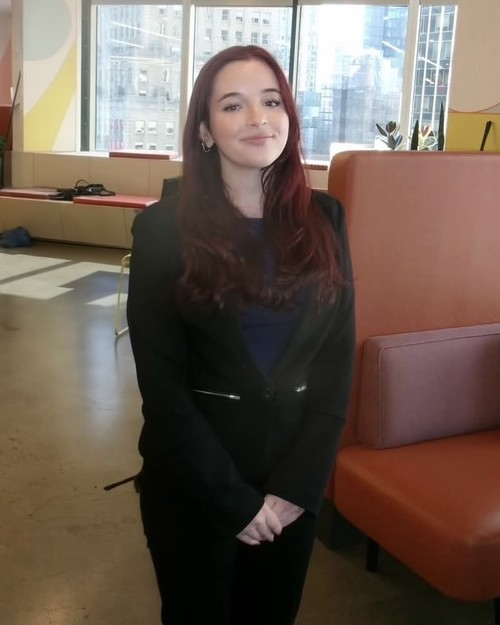

# Zoe Baumrind — Portfolio

A static portfolio site: plain HTML, CSS, and a little JavaScript. No build step, no framework. It deploys directly to GitHub Pages (or Netlify, Vercel, or any static host).

## Pages

| # | Page | File |
|---|------|------|
| 01 | Home — intro, professional interests, project previews | `index.html` |
| 02 | Selected Work — case studies with filters | `work.html` |
| 03 | Culture Lab — original trend research and briefs | `culture-lab.html` |
| 04 | About — story, experience timeline, education, skills, resume | `about.html` |
| 05 | Contact — email, LinkedIn, downloadable resume | `contact.html` |

Shared files:

- `assets/css/style.css` — all styling. Colors and fonts are CSS variables at the top of the file.
- `assets/js/main.js` — mobile nav, work filters, active nav link, footer year.
- `assets/docs/Zoe_Baumrind_Resume.pdf` — the resume that every "Download resume" button points to.
- `assets/img/` — put your photo and any project images here.

## Publish on GitHub Pages

1. Push this repository to GitHub.
2. Repository **Settings → Pages**.
3. Under **Build and deployment**, choose **Deploy from a branch**, pick the branch (for example `main`) and the `/ (root)` folder. Save.
4. The site appears at `https://<your-username>.github.io/<repo-name>/` within a minute or two.

To use a custom domain, add a `CNAME` file containing the domain and point the domain's DNS at GitHub Pages.

## Previewing locally

Open `index.html` in a browser, or run a tiny server from the folder so the relative links behave exactly as they will online:

```
python3 -m http.server 8000
```

Then visit `http://localhost:8000`.

## Editing content

### Add your photo

Save a portrait as `assets/img/zoe.jpg` (a 4:5 crop works best). In `about.html`, replace the `.placeholder` div inside `.hero-photo` with:

```html

```

### Update the resume

Replace `assets/docs/Zoe_Baumrind_Resume.pdf` with a new file using the same name. Every download button keeps working.

### Add a Culture Lab brief

In `culture-lab.html`, copy one of the `<details class="brief">` blocks and edit it. Each brief has five parts: Signal, Why now, Who should care, The play, and Watch-outs. Give the new block a unique `id` (for example `brief-04`), add a row to the Trend radar table, and if it's a favorite, add a teaser card on `index.html` under "From the Culture Lab".

When you publish a brief with dates and sources, also post it on LinkedIn. The post drives people to the site; the site proves you do this consistently.

### Update "On rotation" in the Culture Lab

In `culture-lab.html`, find the `<div class="rotation">` block. Each pick is one `<li>` with a `<strong>` title and a `<span class="why">` one-liner. Replace the example entries with your own and delete the `<span class="tag">Example</span>` line from each. Add or remove `<li>` items freely; the columns adjust.

### Add a Selected Work case study

In `work.html`, copy one of the `<article class="case">` blocks. Set `data-tags` to any of `strategy`, `analytics`, `content`, `leadership` (space-separated) so the filter buttons pick it up. Give it an `id` if you want to link to it from the home page.

To add images to a case, drop them in `assets/img/` and add an `` inside the left column of the case.

### Change colors or fonts

Edit the variables at the top of `assets/css/style.css`:

```css
--red: #8f1d1d;      /* primary */
--cream: #f4ecdc;    /* background */
--ink: #2f0c0c;      /* body text */
```

Fonts are loaded from Google Fonts in the `<head>` of each page: Anton (display), DM Sans (body), Instrument Serif (italic accents).

## Things to review before sharing widely

- The phone number is intentionally left off the site and only lives in the resume PDF.
- The Binghamton Marketing Collective dates on the About page are listed as 2024 – 2025; confirm the end date.
- The three Culture Lab briefs set the format. Replace or extend them with dated, sourced research as you publish it.
- The Selected Work page carries a "work in progress" note. Remove it once the case studies have visuals.

See `JOB-SEARCH-GUIDE.md` for the job-search playbook that goes with this portfolio.
